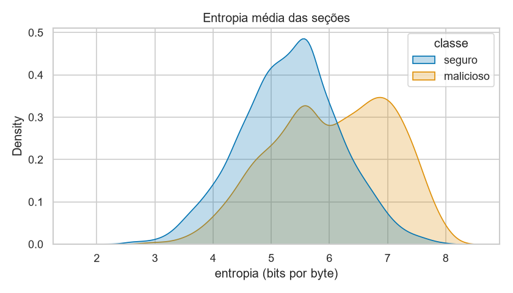
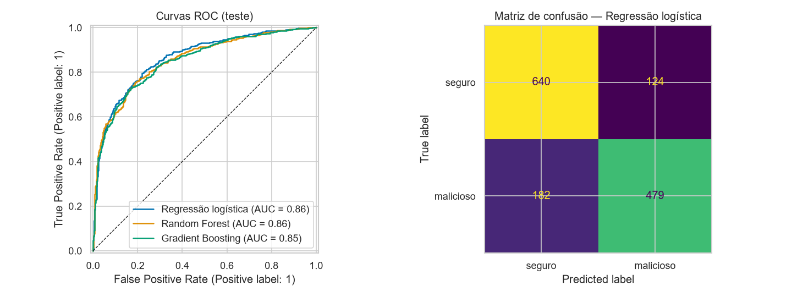

# Projeto Final — Classificação Automática de Arquivos Seguros e Potencialmente Maliciosos com Aprendizagem de Máquina

**Aula:** 25/11 (A1) · Unidade V – Integração e apresentação do projeto final
**Metodologia:** aprendizagem baseada em projetos + apresentação das equipes
**Atividade:** consolidar dados, análise/modelo e resultados; apresentação e discussão entre equipes.
**Entregável:** projeto final.

**Aluna:** Layse Steffany Pereira de Souza · UDF · Sistemas de Informação · 2026/2

> ⚠️ **Status dos resultados:** todo o pipeline está implementado e roda de ponta a ponta. Os números
> deste relatório vêm da **base sintética de demonstração**. Antes da apresentação, gere a amostra
> real do EMBER ([`03_datasets.md`](../unidade3_gestao_de_projetos/03_datasets.md)), reexecute os
> notebooks e atualize as seções 4 a 6.

---

## 1. Problema

Usuários recebem anexos todos os dias e não conseguem distinguir arquivos seguros de maliciosos. A análise
manual não acompanha o volume de novas ameaças. **Pergunta central:** é possível classificar um arquivo
como seguro ou potencialmente malicioso **só com as características estáticas** dele, sem executá-lo?

- **Público-alvo:** usuários de e-mail e equipes de TI de pequenas e médias organizações.
- **Decisão apoiada:** liberar, colocar em quarentena ou encaminhar o arquivo para análise humana.
- Detalhes: [`01_definicao_do_projeto.md`](../unidade3_gestao_de_projetos/01_definicao_do_projeto.md) · plano: [`02_plano_do_projeto.md`](../unidade3_gestao_de_projetos/02_plano_do_projeto.md)

## 2. Dados

- Formato do **EMBER 2018** (características estáticas de executáveis Windows), com 15 variáveis: tamanho, seções, entropias, importações/exportações, strings, assinatura etc.
- Base bruta de demonstração: 6.150 linhas, com problemas de qualidade inseridos de propósito.
- Dicionário de dados: [`03_datasets.md`](../unidade3_gestao_de_projetos/03_datasets.md).

## 3. Tratamento

Nove transformações documentadas ([`documentacao_transformacoes.md`](../unidade5_tratamento_de_dados/documentacao_transformacoes.md)):
padronização de texto e datas → remoção de 150 duplicatas → remoção de 300 amostras sem rótulo →
booleanos para 0/1 → valores impossíveis tratados como ausentes → imputação → consistência entre colunas →
log do tamanho → outliers mantidos. **Resultado: 5.700 linhas, sem ausentes nem duplicatas, e 8 verificações automáticas aprovadas.**

## 4. Análise exploratória e visualizações



- Maliciosos têm **entropia maior** (mediana 6,1 × 5,3) e **menos importações** (56 × 105).
- Sem assinatura digital: 73% dos maliciosos × 47% dos seguros. Seção executável+gravável: 27% × 6%.
- A entropia dos maliciosos **cai ao longo do ano**: eles ficam mais parecidos com software legítimo.
- Nenhuma variável separa as classes sozinha.

Notebooks: [`04_analise_exploratoria`](../unidade2_analise_e_ciencia_de_dados/04_analise_exploratoria.ipynb) · [`05_visualizacoes_comentadas`](../unidade2_analise_e_ciencia_de_dados/05_visualizacoes_comentadas.ipynb)

## 5. Modelos

### Agrupamento (não supervisionado)

O K-Means (k = 3), sem usar o rótulo, encontrou um grupo de **arquivos compactados** (entropia ≈ 6,9, ~22 importações)
com **89% de maliciosos**, um grupo de bibliotecas assinadas (77% seguros) e um grupo misto. É no grupo
misto que os classificadores mais erram. → [`03_agrupamento.ipynb`](../unidade4_aprendizado_maquina/03_agrupamento.ipynb)

### Classificação (supervisionado)

| Modelo | F1 | AUC-ROC | Taxa FP | Taxa FN |
|---|---|---|---|---|
| Linha de base | 0,000 | 0,500 | 0,000 | 1,000 |
| **Regressão logística** | **0,758** | **0,865** | 0,162 | 0,275 |
| Random Forest | 0,748 | 0,856 | 0,149 | 0,300 |
| Gradient Boosting | 0,757 | 0,851 | 0,169 | 0,272 |



Tabela completa e conclusão: [`05_tabela_comparativa_modelos.md`](../unidade4_aprendizado_maquina/05_tabela_comparativa_modelos.md)

## 6. Respostas às perguntas de negócio

| # | Pergunta | Resposta (base de demonstração) |
|---:|---|---|
| 1 | Quais características mais diferenciam os maliciosos? | chaves de registro nas strings, nº de importações, entropias e URLs (importância por permutação); assinatura e seção executável+gravável nos indicadores binários |
| 2 | Com que precisão o modelo classifica? | AUC 0,865 e F1 0,76. Bem acima da linha de base, mas **abaixo da meta** (AUC ≥ 0,95) |
| 3 | Qual o custo de cada erro? Que limiar usar? | não há limiar que atenda FP < 5% e FN < 10% ao mesmo tempo. Recomenda-se **duas faixas**: probabilidade alta → quarentena; intermediária → revisão humana |
| 4 | O desempenho muda com o tempo? | sim: treinar com dados antigos e testar com recentes reduz a AUC em ~0,03, então é preciso **retreinar periodicamente** |
| 5 | Que perfis o modelo erra mais? | malwares "comuns": entropia normal, muitas importações, às vezes assinados. Para eles seria preciso análise dinâmica (fora do escopo) |

**Hipóteses:** H1 confirmada · H2 refutada · H3 confirmada.

## 7. Recomendação

1. Usar o modelo como **filtro de priorização**, e não como bloqueio automático.
2. Mandar direto para a quarentena os arquivos do perfil "compactado" (grupo 2 do K-Means) com probabilidade alta.
3. Retreinar o modelo periodicamente e monitorar a taxa de falsos negativos.

## 8. Limitações e próximos passos

- **Rodar com o EMBER real** (prioridade) e comparar com os resultados de referência da literatura.
- Mover a imputação para dentro de um `Pipeline` (sem vazamento) e fazer busca de hiperparâmetros.
- Usar mais características do EMBER (histograma de bytes, nomes das funções importadas).
- Escopo atual: só executáveis Windows e só análise estática.

## 9. Como reproduzir

```bash
pip install -r requirements.txt
python -m src.gerar_dados_sinteticos   # ou: python -m src.extrair_amostra_ember PASTA_EMBER
python -m src.preparacao
jupyter notebook                        # executar os notebooks na ordem do README
```

Roteiro da apresentação: [`apresentacao.md`](apresentacao.md)
