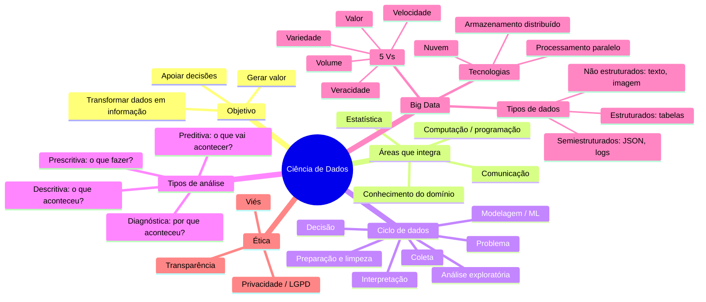

# Mapa Conceitual — Ciência de Dados e Big Data

**Aula:** 05/08 · Unidade I – Big Data
**Metodologia:** aula expositiva dialogada + estudo de caso + TBL
**Atividade:** identificar problemas que podem ser solucionados com dados e discutir os conceitos de Big Data.
**Entregável:** mapa conceitual sobre Ciência de Dados e Big Data.

---

## 1. Mapa conceitual

> O diagrama usa a sintaxe Mermaid, renderizada automaticamente pelo GitHub.

## 2. Relações principais (leitura do mapa)

| Conceito | Relação | Conceito |
|---|---|---|
| Ciência de Dados | **usa** | estatística, computação e conhecimento do domínio |
| Ciência de Dados | **segue** | um ciclo que vai do problema à decisão |
| Big Data | **é caracterizado pelos** | 5 Vs |
| Big Data | **exige** | tecnologias de armazenamento e processamento distribuído |
| Dados | **viram** | informação quando são organizados e interpretados |
| Informação | **vira** | conhecimento e decisão quando responde a uma pergunta de negócio |
| Veracidade | **condiciona** | o Valor: dados ruins geram decisões ruins |
| Ética e LGPD | **limitam e orientam** | a coleta e o uso dos dados |

## 3. Problemas que podem ser resolvidos com dados

| Área | Problema | Dados úteis | Tipo de análise |
|---|---|---|---|
| Educação | Evasão de alunos (tema da atividade [Detetives dos Dados](detetives_de_dados.md)) | frequência, notas, financeiro, acessos ao AVA | preditiva |
| Segurança da informação | Anexos de e-mail maliciosos (tema do [projeto da disciplina](../unidade3_gestao_de_projetos/01_definicao_do_projeto.md)) | características estáticas dos arquivos | preditiva / classificação |
| Saúde | Lotação de pronto-socorro | histórico de atendimentos, clima, calendário | preditiva |
| Comércio | Ruptura de estoque | vendas, estoque, sazonalidade | preditiva / prescritiva |
| Transporte | Atrasos em linhas de ônibus | GPS dos veículos, trânsito, horários | descritiva / diagnóstica |

## 4. Síntese

Ciência de Dados é o processo de **fazer boas perguntas e respondê-las com dados**. Big Data
descreve o cenário em que os dados são tão grandes, rápidos ou variados que as ferramentas
tradicionais não dão conta. Ter Big Data não garante valor: o valor vem de um problema bem
definido, de dados confiáveis e de uma análise que chega a quem decide.

## Referências

- IBM. *What is data science?* Disponível em: https://www.ibm.com/think/topics/data-science.
- CARVALHO, A. C. P. L. F.; MENEZES, A.; BONIDIA, R. *Ciência de Dados: Fundamentos e Aplicações*. Disponível em: https://bonidia.github.io/cd-fundamentos/.
