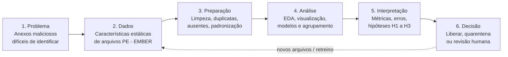

# Pipeline de Ciência de Dados

**Aula:** 19/08 · Unidade II – Análise e Ciência de Dados
**Metodologia:** aula prática + demonstração + TBL
**Atividade:** construir o fluxo problema → dados → preparação → análise → interpretação → decisão.
**Entregável:** pipeline de Ciência de Dados.

> O pipeline do problema da evasão escolar, feito em equipe em sala, está em
> [`unidade1_big_data/detetives_de_dados.md`](../unidade1_big_data/detetives_de_dados.md) (seção 14).
> Abaixo está o pipeline aplicado ao projeto da disciplina, com o arquivo do repositório que implementa cada etapa.

| Etapa | Pergunta-chave | O que é feito | Onde está no repositório |
|---|---|---|---|
| 1. Problema | Que decisão precisamos apoiar? | Definir problema, público, objetivos e perguntas de negócio | [`01_definicao_do_projeto.md`](../unidade3_gestao_de_projetos/01_definicao_do_projeto.md) |
| 2. Dados | Que dados respondem às perguntas? | Escolher fontes, verificar licença, volume e variáveis | [`03_datasets.md`](../unidade3_gestao_de_projetos/03_datasets.md), [`src/extrair_amostra_ember.py`](../src/extrair_amostra_ember.py) |
| 3. Preparação | Os dados são confiáveis? | Remover duplicatas e amostras sem rótulo, padronizar formatos, tratar ausentes e inválidos | [`src/preparacao.py`](../src/preparacao.py), [`tratamento_de_dados.ipynb`](../unidade5_tratamento_de_dados/tratamento_de_dados.ipynb) |
| 4. Análise | Que padrões existem? | EDA, gráficos, modelos supervisionados e agrupamento | [`04_analise_exploratoria.ipynb`](04_analise_exploratoria.ipynb), [`05_visualizacoes_comentadas.ipynb`](05_visualizacoes_comentadas.ipynb), [`unidade4_aprendizado_maquina/`](../unidade4_aprendizado_maquina/) |
| 5. Interpretação | O resultado é bom o bastante? Onde erra? | Comparar métricas com metas, testar hipóteses, analisar erros e limitações | [`04_avaliacao_modelos.ipynb`](../unidade4_aprendizado_maquina/04_avaliacao_modelos.ipynb) |
| 6. Decisão | O que fazer com o resultado? | Definir limiar e regra de uso (bloquear, quarentena, revisão humana) e quando retreinar | [`projeto_final/relatorio_final.md`](../projeto_final/relatorio_final.md) |

**Observação:** o pipeline é **cíclico**. Novos arquivos e a deriva temporal exigem voltar à etapa
de dados e retreinar o modelo periodicamente.
