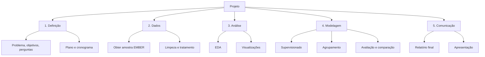

# Plano do Projeto de Ciência de Dados

**Aula:** 16/09 · Unidade III – Gestão de Projetos
**Metodologia:** TBL + oficina prática
**Atividade:** definir dados necessários, etapas, ferramentas, responsabilidades e cronograma.
**Entregável:** plano do projeto de Ciência de Dados.

**Projeto:** Classificação Automática de Arquivos Seguros e Potencialmente Maliciosos com Aprendizagem de Máquina
**Documento de definição:** [`01_definicao_do_projeto.md`](01_definicao_do_projeto.md)

---

## 1. Dados necessários

| Dado | Variáveis | Fonte | Para que serve | Pergunta de negócio |
|---|---|---|---|---|
| Rótulo do arquivo | `label` (0 = seguro, 1 = malicioso, −1 = sem rótulo) | EMBER 2018 | variável-alvo | P2, P3 |
| Cabeçalho e geral | tamanho, nº de importações e exportações, assinatura, debug, recursos | EMBER (`general`) | características | P1 |
| Seções | nº de seções, entropia média e máxima, seção executável+gravável | EMBER (`section`) | características (H1) | P1, P5 |
| Strings | nº de strings, entropia, URLs, caminhos, chaves de registro | EMBER (`strings`) | características | P1 |
| Data | mês de aparição (`appeared`) | EMBER | avaliação temporal (H3) | P4 |

Detalhes de acesso: [`03_datasets.md`](03_datasets.md).

## 2. Etapas (estrutura analítica do projeto)

## 3. Ferramentas

| Necessidade | Ferramenta | Motivo |
|---|---|---|
| Linguagem | Python 3 | padrão em ciência de dados, gratuito |
| Ambiente | Jupyter / Google Colab | notebooks executáveis, sem instalar nada no Colab |
| Manipulação de dados | pandas, NumPy | leitura, limpeza e transformação |
| Visualização | Matplotlib, Seaborn | gráficos da EDA e dos resultados |
| Aprendizado de máquina | scikit-learn | regressão logística, Random Forest, Gradient Boosting, K-Means, métricas |
| Estatística | SciPy | teste de Mann-Whitney (H1) |
| Alternativa visual | Orange Data Mining | conferir resultados sem código, como em aula |
| Versionamento | Git + GitHub | histórico e entrega do código |

Dependências: [`requirements.txt`](../requirements.txt).

## 4. Responsabilidades (matriz RACI)

R = responsável, A = aprova, C = consultado, I = informado.

| Atividade | Layse Steffany | Professor(a) da disciplina | Outros integrantes (se houver) |
|---|---|---|---|
| Definição do problema | R | A | C |
| Obtenção dos dados | R | I | C |
| Tratamento dos dados | R | I | C |
| EDA e visualizações | R | I | R (visualizações) |
| Modelagem e avaliação | R | C | C |
| Relatório e apresentação | R | A | R (slides) |

> A definição do projeto prevê papéis "a definir" para revisão e comunicação. Atualize esta matriz se a equipe tiver mais integrantes.

## 5. Cronograma (alinhado ao plano de aulas 2026/2)

| Semana / aula | Etapa | Entregável | Arquivo |
|---|---|---|---|
| 09/09 | Definição do problema e dos objetivos | Documento de definição | [`01_definicao_do_projeto.md`](01_definicao_do_projeto.md) |
| 16/09 | Planejamento | Plano do projeto (este documento) | `02_plano_do_projeto.md` |
| 23/09 | ENADE (simulado), sem entrega do projeto | — | — |
| 30/09 | Datasets e tratamento inicial | Datasets acessíveis | [`03_datasets.md`](03_datasets.md) |
| 07/10 | Introdução ao ML: tipo de problema | Quadro comparativo | [`01_quadro_comparativo...`](../unidade4_aprendizado_maquina/01_quadro_comparativo_supervisionado_nao_supervisionado.md) |
| 14/10 | Primeiro modelo supervisionado | Notebook com modelo | [`02_modelo_supervisionado.ipynb`](../unidade4_aprendizado_maquina/02_modelo_supervisionado.ipynb) |
| 21/10 | Sem aula presencial (apresentações de IHC) | — | — |
| 28/10 | Agrupamento | Análise dos grupos | [`03_agrupamento.ipynb`](../unidade4_aprendizado_maquina/03_agrupamento.ipynb) |
| 11/11 | Comparação e avaliação dos modelos | Tabela comparativa + conclusão | [`04_avaliacao_modelos.ipynb`](../unidade4_aprendizado_maquina/04_avaliacao_modelos.ipynb) |
| 18/11 | Tratamento final dos dados | Dataset tratado + documentação | [`tratamento_de_dados.ipynb`](../unidade5_tratamento_de_dados/tratamento_de_dados.ipynb) |
| 25/11 (A1) | Integração e apresentação | Projeto final | [`projeto_final/`](../projeto_final/) |
| 09/12 (AF) | Avaliação final | Dataset tratado + documentação | [`unidade5_tratamento_de_dados/`](../unidade5_tratamento_de_dados/) |

## 6. Riscos e acompanhamento

Os riscos estão na seção 13 da definição do projeto. Acompanhamento: revisar este plano a cada
aula, marcando o status de cada entrega no [`README.md`](../README.md).
