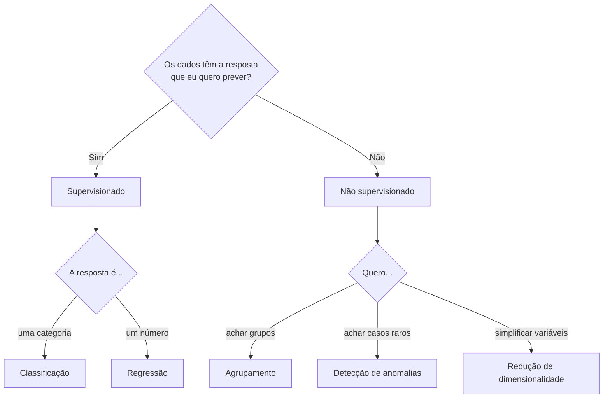

# Quadro Comparativo: Aprendizado Supervisionado × Não Supervisionado

**Aula:** 07/10 · Unidade IV – Aprendizado de Máquina
**Metodologia:** aula expositiva + exemplos + PBL
**Atividade:** diferenciar aprendizado supervisionado e não supervisionado e identificar aplicações.
**Entregável:** quadro comparativo + classificação de problemas.

Material de apoio: [`introducao_google_ml.md`](introducao_google_ml.md) (Google for Developers).

---

## 1. Quadro comparativo

| Critério | Supervisionado | Não supervisionado |
|---|---|---|
| **Dados de treino** | rotulados: cada exemplo tem a resposta certa (`label`) | sem rótulo: só as características |
| **Objetivo** | aprender a prever o rótulo de novos exemplos | descobrir estrutura escondida: grupos, padrões, anomalias |
| **Pergunta típica** | "Este arquivo é malicioso?", "Quanto vai custar?" | "Que tipos de arquivo existem?", "Quais clientes são parecidos?" |
| **Tarefas** | **classificação** (categoria) e **regressão** (número) | **agrupamento** (clustering), redução de dimensionalidade, detecção de anomalias, regras de associação |
| **Algoritmos** | regressão logística, árvore de decisão, Random Forest, Gradient Boosting, k-NN, SVM, regressão linear | K-Means, DBSCAN, agrupamento hierárquico, PCA, Isolation Forest |
| **Como avaliar** | comparar a previsão com o rótulo real: acurácia, precisão, recall, F1, AUC (classificação); MAE, RMSE, R² (regressão) | sem gabarito: silhueta, inércia, Davies-Bouldin e, principalmente, **interpretação** por especialistas |
| **Custo dos dados** | alto: rotular exige tempo e especialistas | baixo: usa dados brutos |
| **Vantagem** | objetivo claro e desempenho mensurável | encontra padrões que ninguém procurou |
| **Limitação** | depende da qualidade e da quantidade de rótulos | resultados podem ser difíceis de interpretar ou não ter sentido prático |
| **No nosso projeto** | classificar arquivos como seguros ou maliciosos ([`02_modelo_supervisionado`](02_modelo_supervisionado.ipynb), [`04_avaliacao_modelos`](04_avaliacao_modelos.ipynb)) | agrupar arquivos por perfil sem usar o rótulo ([`03_agrupamento`](03_agrupamento.ipynb)) |

## 2. Classificação de problemas

| # | Problema | Tipo | Tarefa | Justificativa |
|---:|---|---|---|---|
| 1 | Dizer se um anexo de e-mail é malicioso | Supervisionado | Classificação | há histórico de arquivos rotulados (seguro/malicioso) |
| 2 | Estimar o tempo de resolução de um chamado de TI | Supervisionado | Regressão | a resposta é um número (horas), conhecido nos chamados antigos |
| 3 | Prever se um aluno vai evadir no próximo semestre | Supervisionado | Classificação | histórico de alunos que evadiram ou não |
| 4 | Segmentar clientes de uma loja por comportamento de compra | Não supervisionado | Agrupamento | não existe "grupo certo" prévio |
| 5 | Detectar transações de cartão fora do padrão sem casos de fraude rotulados | Não supervisionado | Detecção de anomalias | busca o que foge do comportamento normal |
| 6 | Prever o preço de um imóvel | Supervisionado | Regressão | preço de venda conhecido em imóveis vendidos |
| 7 | Classificar e-mails como spam ou não spam | Supervisionado | Classificação | usuários marcam spam (rótulo) |
| 8 | Agrupar arquivos maliciosos por semelhança para descobrir famílias novas | Não supervisionado | Agrupamento | as famílias novas ainda não têm nome |
| 9 | Recomendar produtos comprados juntos | Não supervisionado | Regras de associação | descobre padrões de coocorrência |
| 10 | Prever a demanda de energia de amanhã | Supervisionado | Regressão (série temporal) | consumo dos dias anteriores é conhecido |

## 3. Conclusão

A escolha depende de **ter ou não o rótulo** e do **tipo de resposta**. No projeto, as duas abordagens
se complementam: o supervisionado responde "é malicioso?", e o não supervisionado mostra **que tipos**
de arquivo existem e em quais perfis o classificador tende a errar.
